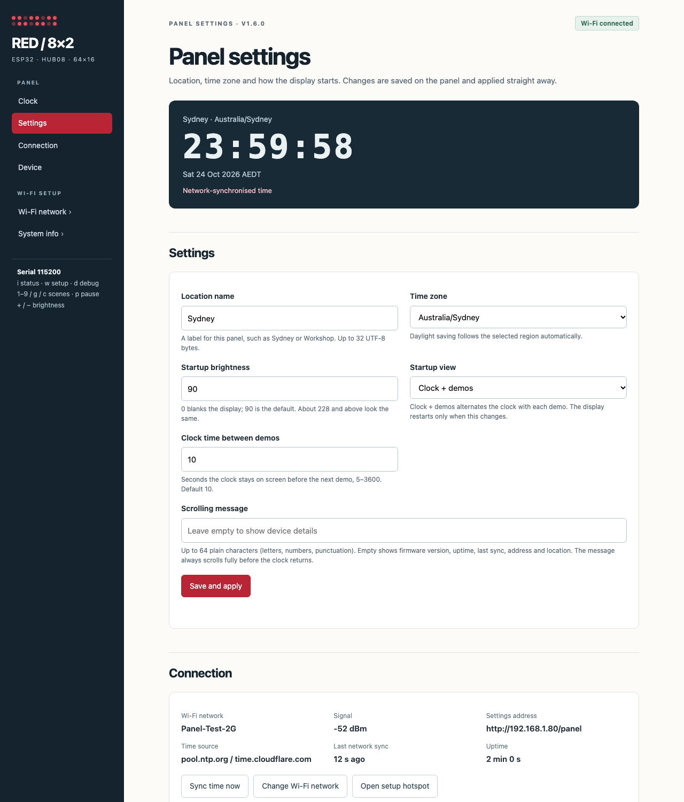

# ESP32 reference test configuration

A complete bench setup for the **64×16 red HUB08 panel**, with Wi-Fi provisioning, network time and an embedded settings page. These are reproducible connection and acceptance instructions; host tests and a firmware build do not establish physical Wi-Fi, power or signal performance.

## Hardware and software

| Item | Reference configuration |
|:--|:--|
| Controller | Classic ESP32 DevKit with ESP-WROOM-32, 4 MB flash; PlatformIO `esp32dev` |
| Panel | Red P3.75 HUB08, 64×16 pixels, sixteen 8×8 modules, 1/16 scan |
| Logic interface | EzSBC LS1 on the reference panel; a 5 V 74AHCT245 with 100 nF decoupling is the actively driven alternative |
| Panel power | Regulated 5 V through VCC/GND screw terminal; a 2–3 A supply is a starting recommendation, not a measured maximum rating |
| ESP32 power | USB data cable; common ground with panel and buffer |
| Network | 2.4 GHz Wi-Fi, for example a WPA2-Personal test SSID; DHCP enabled |
| Framework | Arduino on `espressif32@6.9.0` (Arduino core 2.0.17) |
| Libraries | Adafruit GFX `^1.11.9`, WiFiManager **2.0.17**; WiFi, Preferences, mDNS and SNTP from the ESP32 core |
| Serial | **115200 baud**, one-key commands without Enter |

The ESP32 radio uses 2.4 GHz Wi-Fi. Use the classic ESP32 target here; arbitrary ESP32 variants have different GPIO and timer arrangements. [Espressif ESP32 datasheet](https://www.espressif.com/sites/default/files/documentation/esp32_datasheet_en.pdf)

## Exact electrical connections

Power off while wiring. Connect panel VCC and buffer VCC to the regulated 5 V rail. Connect **panel GND, buffer GND and ESP32 GND** together. Supply panel LED current through its terminal, not through the ESP32 board.

For the standard 20-pin **74AHCT245**:

- **Pin 20/VCC → 5 V**, **pin 1/DIR → 5 V** for A-to-B operation.
- **Pin 10/GND → common GND**, **pin 19 (/OE) → GND** to enable the buffer.
- **100 nF** between pins 20 and 10 close to the chip.

| ESP32 pin label / GPIO | Buffer input | Buffer output | Matrix INPUT200 signal | Contact in rear-upright reference |
|:--|:--|:--|:--|:--|
| IO25 / GPIO 25 | A1 / 2 | B1 / 18 | LA | Row 1, right |
| IO26 / GPIO 26 | A2 / 3 | B2 / 17 | LB | Row 2, right |
| IO27 / GPIO 27 | A3 / 4 | B3 / 16 | LC | Row 3, right |
| IO13 / GPIO 13 | A4 / 5 | B4 / 15 | LD | Row 4, right |
| IO22 / GPIO 22 | A5 / 6 | B5 / 14 | EN | Row 4, left |
| IO23 / GPIO 23 | A6 / 7 | B6 / 13 | R1 | Row 5, left |
| IO4 / GPIO 4 | A7 / 8 | B7 / 12 | LT | Row 7, right |
| IO18 / GPIO 18 | A8 / 9 | B8 / 11 | SK | Row 8, right |
| GND | Pin 10 and /OE pin 19 | Common ground | GND | Left rows 1/2/3/7/8 |

GPIO numbers are the labels printed on the development board, not physical header positions. R2, G1 and G2 are unused. Connect to **INPUT200**, beside U201, rather than the cascade output.

The contact positions use this board's labelled OUTPUT201 and matching checked INPUT200 ground orientation. They are not a universal HUB08 pin-numbering convention. See the [connector photos and orientation](PANEL_GUIDE.md#connector-reference) before attaching an unmarked header. [TI buffer pinout](https://www.ti.com/lit/ds/symlink/sn74ahct245.pdf)

For an **EzSBC LS1**, use VLo = ESP32 3.3 V, VHi = panel 5 V, shared GND, and eight matching Lo/Hi channels. Do not apply the AHCT245 package pin numbers to an LS1 board. The [guide](PANEL_GUIDE.md#power-and-level-shifting) explains the difference.

## Firmware defaults

| Setting | Value / behaviour |
|:--|:--|
| Firmware | `1.3.0`: Wi-Fi firmware upload (OTA) after the v1.2.0 refresh driver |
| LA/LB/LC/LD | GPIO 25/26/27/13; normal A/B/C/D bit order |
| EN/R1/LT/SK | GPIO 22/23/4/18 |
| Geometry and scan | 64×16, 1/16 scan; 500 µs per row, nominal 125 Hz complete refresh |
| Signal phase / row guard | 1 µs address/latch phases / 50 µs |
| Column shift | VSPI hardware SPI, 500 kHz, while the previous row is lit |
| Data / EN polarity | Active LOW / active LOW |
| Orientation | Reversed column stream, row XOR `0x0F` |
| Default location | **Sydney** |
| Default time zone | **Australia/Sydney**, with automatic daylight saving |
| POSIX rule | `AEST-10AEDT,M10.1.0,M4.1.0/3` |
| Startup brightness / view | **90/255**, **Clock + demos** |
| Boot cards | Three cards, 2 seconds each: header/version, geometry/brightness, network/time state |
| Clock drawing interval / visit | 250 ms redraw; 10 seconds between demos, from elapsed milliseconds |
| Refresh scheduling | Hardware TG0/T0 row cadence + TG0/T1 OE deadline; dedicated scan task on core 1 |
| NTP servers | `pool.ntp.org`, `time.cloudflare.com` |
| Unsynchronised NTP retry | Every 60 seconds while Wi-Fi is connected |
| Clock holdover limit | 24 hours without a sync, then the waiting display |
| Wi-Fi connection window | 10 seconds before opening the setup hotspot |
| Saved-network retry | Every 30 seconds while offline, with no client on the setup hotspot |
| Serial debug default | Level 3 / INFO; `d` cycles runtime levels 0–4 |
| Persistent storage | ESP32 NVS: Wi-Fi credentials managed by WiFiManager; one validated panel settings record under `redpanel/clock` |

Changing the time zone changes how UTC is displayed, not the underlying network time. The location name is a label; it does not geolocate the device or contact a location service. Choose the matching time zone explicitly. Sydney's POSIX rule is from the [Arduino time-zone reference](https://github.com/esp8266/Arduino/blob/master/cores/esp8266/TZ.h).

## Build and first connection

From the PlatformIO terminal:

```sh
pio run
pio device list
pio run --target upload
pio device monitor --baud 115200
```

No separate filesystem upload is required: the settings page is compiled into flash. The ESP32 shows boot cards and prints its header, GPIO mapping, timing, location and network settings. The playlist continues while the first Wi-Fi connection is attempted.

With no usable saved network, wait about 10 seconds, then join:

| Connection item | Value |
|:--|:--|
| Setup SSID | **`RedPanel-ABCDEF`** — ABCDEF is an example; use the suffix printed by your ESP32 |
| Setup password | **`PanelSetup32`** — default `SECRET_AP_PASSWORD`; override in gitignored `include/secrets.h` |
| Captive portal / Wi-Fi selection | **`http://192.168.4.1/`** |
| Panel settings on the hotspot | **`http://192.168.4.1/`** (also `/panel`); Wi-Fi network is in the sidebar |
| Example router SSID | **`Panel-Test-2G`** — create or substitute your own network |
| Router password | Enter your own password in WiFiManager; no router password is supplied or committed |

If a phone does not open the captive portal, stay connected to the hotspot and enter the HTTP address manually. Select your 2.4 GHz network and enter its password. WiFiManager saves the credentials on the ESP32. Normal firmware uploads retain NVS; a full flash erase removes the saved credentials and panel settings. Its save/connect operation can briefly pause animation for roughly the two-second portal-close delay plus an eight-second association window; **panel scanning continues**.

After joining the router, the setup hotspot closes and serial reports the assigned IP and settings URL. Rejoin your normal Wi-Fi network and open:

```text
http://192.168.1.80/          Example DHCP address only: use the actual serial-reported IP.
http://red-panel-abcdef.local/  Example mDNS name: use your actual chip suffix.
```

mDNS depends on the client/network; the printed IP works without it. The router's DHCP address is not hard-coded. A router reservation can keep it stable. Use a trusted local network for this plain HTTP configuration page. To require a login, copy `include/secrets.example.h` to `include/secrets.h` and set `SECRET_PANEL_PASSWORD`; `/panel` and `/api/*` then ask for user **`admin`** and that password (HTTP Basic, not encrypted). WiFiManager's own `/wifi` pages are not covered by this login.

### Network services

| Service | Connection |
|:--|:--|
| Configuration HTTP | Browser → panel, TCP port 80 |
| Captive DNS | Phone → setup hotspot, UDP port 53 |
| Router DHCP / DNS | ESP32 receives its address and resolves the NTP hosts |
| Network time | ESP32 → NTP servers, UDP port 123 |
| mDNS | Local hostname discovery, UDP port 5353 |
| Firmware upload (OTA) | Computer → panel UDP 3232 invitation, then panel → computer TCP transfer; password required |

Internet access is used for network time, not for storing or reading your local settings. Network restrictions on DNS or UDP 123 can leave the clock waiting even when Wi-Fi is connected.

## Web settings and status



*Browser preview using mock test-network data. The live page reads its status from your ESP32.*

The page opens at **`/`** (or `/panel`). Its sidebar jumps between **Clock**, **Settings**, **Connection** and **Device**, and links to WiFiManager's **Wi-Fi network** and **System info** pages, which show a matching bar back to the settings. In the setup hotspot a **Close setup hotspot** link also appears. Under **Settings**, set:

1. **Location name:** 1–32 UTF-8 bytes; defaults to Sydney.
2. **Time zone:** choose a listed region. Australian zones, Auckland, UTC and several international zones are included.
3. **Startup brightness:** 0–255; default 90. This is the requested on-time; roughly 228–255 look the same.
4. **Startup view:** Clock + demos or Real-time clock. Clock + demos starts with 10 seconds of clock, runs one demo, returns to the clock for 10 seconds, then runs the following demo.

Choose **Save and apply**. The ESP32 validates the complete form, saves one record, and changes the local time zone and brightness at once. The display restarts only when the startup view changed. Settings survive reset. A failed flash write leaves the previous settings active. Serial `+`/`-` changes are saved as the startup brightness once, five seconds after the last key press.

The page shows the ESP32's time, location, date/zone, network name, signal, address, uptime, last sync age, firmware version, Wi-Fi upload (OTA) state and hardware settings. Its clock is read from the **panel**, not from the browser. **Sync time** requests another NTP update. **Wi-Fi network** opens WiFiManager's network form. **Open setup hotspot**, or serial **`w`**, opens provisioning again without erasing saved settings.

Status requests are read-only. Panel settings/sync/setup API mutations carry a boot-local token to prevent unrelated cross-origin pages from submitting changes. The page and APIs contain no Wi-Fi passwords; WiFiManager's internal debug output is disabled.

## Live clock behaviour

Send **`c`** to keep the live clock on screen. **`p`** resumes the playlist's clock-scene timer; **`n`** moves to the next demo (letters immediately after a fresh boot/restart). With clock selected as the startup view, it remains visible after boot.

- Before the first valid NTP response: **NO WIFI / JOIN AP**, or **SYNC TIME / WAIT NTP**.
- After sync: local **HH:MM:SS**, colons lit for the first half of each second, seconds bar and **NTP** label.
- After losing Wi-Fi: time continues from the ESP32's last sync, with **HLD** (holdover). Accuracy can drift until reconnection; after 24 hours without a sync the clock returns to the waiting display.
- After reset or power loss: this firmware waits for a new network sync; it does not invent a sample time.
- Pausing the playlist **does not freeze the clock**. Resuming or reselecting `c` does not reset the actual time.

The clock uses `configTzTime()` and `localtime_r()` with a region-specific daylight-saving rule. [Espressif Arduino time implementation](https://github.com/espressif/arduino-esp32/blob/2.0.17/cores/esp32/esp32-hal-time.c), [WiFiManager 2.0.17](https://github.com/tzapu/WiFiManager/tree/v2.0.17)

## Boot/status and debug conventions

Serial **`i`** repeats the startup/settings report. A representative header is:

```text
[INFO] ============================================================
[INFO] Red LED Panel 8x2 v1.3.0 | ESP32 DevKit / esp32dev
[INFO] Panel=64x16, 1/16 scan, brightness=90/255, debug=3
[INFO] GPIO LA=25 LB=26 LC=27 LD=13 EN=22 R1=23 LT=4 SK=18
[INFO] Scan=500 us/row, signal=1 us, guard=50 us, nominal frame=125 Hz
[INFO] [settings] Location=Sydney zone=Australia/Sydney rule=AEST-10AEDT,M10.1.0,M4.1.0/3
```

Application logging follows the shared convention: **0 Off**, **1 Error `[ERR ]`**, **2 Warn `[WARN]`**, **3 Info `[INFO]`**, **4 Verbose `[VERB]`**. Boot default comes from `-DDEBUG_LEVEL=3`; one shared runtime `debugLevel` applies across source files. `d` cycles it. INFO logs startup/settings and transitions; frequent retry/brightness details use VERBOSE. Credentials are never printed.

C++ uses two spaces, attached braces and a 100-column limit in [.clang-format](../.clang-format). [.editorconfig](../.editorconfig) records whitespace and newline rules. To reproduce formatting and checks:

```sh
python3 -m venv .venv-docs
.venv-docs/bin/python -m pip install -r tools/dev-requirements.txt
.venv-docs/bin/clang-format --dry-run --Werror src/*.cpp src/*.h include/config.h include/debug.h include/ClockSettings.h include/secrets.example.h
.venv-docs/bin/python tools/render_examples.py
.venv-docs/bin/python tools/build_docs.py
```

`include/ConfigPage.h` is generated from [web/index.html](../web/index.html). PlatformIO embeds it automatically before each build through `tools/pio_prepare.py`; **`python3 tools/embed_web.py`** also regenerates it directly. Host regressions use the installed GFX library plus test doubles for GPIO, Wi-Fi, HTTP and storage; they do not configure any real network.

## Bench acceptance checks

| Action | Expected result |
|:--|:--|
| First boot without saved Wi-Fi | Three boot cards, useful serial settings, clock waiting state for 10 seconds, then letters; setup hotspot appears after the connection window |
| Send `r`, let the cycle run | Clock 10 s → letters → clock 10 s → checkerboard → clock, continuing through Pong and repeating |
| Save valid router credentials | DHCP IP/settings URL printed, settings page available from the LAN |
| Wait for NTP, send `c` | Correct local HH:MM:SS; no simulated starting time |
| Change Sydney to Brisbane | Correct regional time; Sydney observes DST, Brisbane does not |
| Save location/brightness/Clock and reset | Saved values restored; clock waits for sync, then stays on screen |
| Pause or reselect clock | Time continues; selection does not reset it |
| Disconnect router after sync | Clock continues with HLD, reconnect/setup fallback is available |
| Enter a wrong router password | Portal remains usable; display refresh continues |
| Use `w` while connected | Setup hotspot opens; no credentials or panel settings are erased |
| Send invalid settings through the API | HTTP 400; existing settings retained |
| `1`–`9`, `g`, `p`, `n`, `r`, `f/o/b` | Demo and held-pattern controls retain their documented behaviour |
| `o`, then `+` to 255 (v1.2.0) | Noticeably brighter than 135/255; no ghosting in unlit rows; `i` counters steady |
| `+` then wait 5 s, reset | New brightness restored at boot |
| OTA upload with the right password (v1.3.0) | Panel shows OTA progress, restarts, serial reports the new version |
| OTA upload with a wrong password | Upload refused; current firmware keeps running |
| Open `http://<panel>/` and use the sidebar | Each section scrolls into view; Wi-Fi network and System info show the bar back |

See [screen examples](SCREEN_EXAMPLES.md) for generated output from every scene, boot cards and clock states. The reference-panel results below confirm observed Wi-Fi association, NTP sync, scene progression and a visually steady display. Use the acceptance table to check the remaining scenarios on your own installation.

## Blank screen with refresh setup error

If serial reports `timer_isr_callback_add: register interrupt service failed`, `ESP_ERR_NOT_FOUND` and `Refresh: rows=0`, the display scanner has not started. Application scene messages and Wi-Fi can still work while OE remains blanked. The earlier driver requested two exclusive level-3 interrupts; the corrected driver uses shared IRAM interrupts at an available level 1–3. This log identifies a firmware interrupt allocation failure.

Build/upload the corrected firmware and reset. Successful startup includes:

```text
[INFO] HUB08 panel 64x16 started, row period 500 us (125 Hz frame)
[INFO] Refresh: hardware timers TG0/T0+T1, shared IRAM interrupts, scan task on core 1
[INFO] Shift: VSPI 500000 Hz on SK=18 R1=23, overlapped with the lit row
```

Send `t` to hold letters, then `i` twice a few seconds apart. The row count should be nonzero and increasing. A remaining setup error names the failed stage (for example, `row interrupt`); capture that line. Host tests model constrained allocation and startup cleanup. The reference-panel check below confirms that the corrected firmware started refresh and displayed successfully.

## Check display flicker

Upload the new firmware, reset, and keep Serial Monitor at **115200 baud**. Use **`r`** to verify clock (10 s) → letters → clock (10 s) → checkerboard, then further demos. A saved **Real-time clock** startup view stays on the clock; choose **Clock + demos** on the settings page to make the alternating cycle the boot default.

For a steady reference send **`t`** (letters), then **`i`**. Observe the whole display by eye for 30 seconds; reload `/panel` several times, then send **`i`** again. Repeat with **`o`** (all on) at the normal 90/255 brightness. The status line includes:

```text
Refresh: rows=..., missed ticks=..., late rows=..., max wake=... us, max scan=... us
```

Counters are cumulative since reset. Compare the two readings: missed ticks and late rows should stay unchanged during steady operation and normal page polling. Increasing values indicate missed refresh deadlines; record both reports and which action triggers them. Max wake/scan values are lifetime peaks, including startup or earlier flash saves, so reset for a fresh comparison. Saving settings or Wi-Fi credentials writes flash and can cause a brief disturbance; check that steady output resumes afterwards.

The driver isolates refresh from the shared timer task and commits pictures between scans. The v1.2.0 overlapped SPI shift passed this check on the reference panel (below). Host tests verify these decisions, but do not measure real interrupt latency or prove the LEDs are flicker-free. **Clock colons light for half of each second and hearts change brightness intentionally.** Camera bands can persist at 125 Hz even with a steady appearance by eye; see the [photography guidance](PANEL_GUIDE.md#photographing-the-display).

## Recorded reference-panel result (v1.3.0) — 25 October 2026

v1.3.0 was flashed over USB from the iMac with `SECRET_PANEL_PASSWORD` and `SECRET_OTA_PASSWORD` set. `/api/status` reported version **1.3.0**, `ota: ready` and synchronised time. Without credentials, `/`, `/panel` and `/api/status` returned **401**; with user `admin` and the page password they returned **200**. The user confirmed the new settings UI and login work in the browser. A first OTA upload had not yet been run when this was recorded; use the OTA rows of the acceptance table for that check.

A local `secrets.h` copied from an older template lacked `SECRET_OTA_PASSWORD`, and the build stopped with `'SECRET_OTA_PASSWORD' was not declared`. Add the line from `include/secrets.example.h` to fix it.

## Recorded reference-panel result (v1.2.0) — 25 October 2026

After flashing v1.2.0, the user reported **"Everything seems to be working"**. The serial log shows the new start-up line `Shift: VSPI 500000 Hz on SK=18 R1=23, overlapped with the lit row`, Wi-Fi association, NTP synchronisation (06:58:47 AEDT) and normal clock/demo progression. Checks covered held letters, all-on from 90 to 255/255 and back to 0, and serial brightness saving: 240, 255 and 105 were each saved five seconds after the last key press, and 105 was restored after a power-on reset.

| Refresh metric | Before reset | After reset |
|:--|--:|--:|
| Rows (latest reading) | 533,851 | 108,216 |
| Missed ticks | 0 | 0 |
| Late rows | 0 | 0 |
| Maximum wake | 237 µs | 189 µs |
| Maximum scan | 489 µs | 457 µs |

Every reading in the session showed zero missed ticks and late rows, compared with 39 and 45 in the v1.1.0 totals below, and the peak wake delay roughly halved. Maximum scan now includes the 128 µs SPI shift that overlaps the lit row. One cold power-on printed `flash read err, 1000` from the ESP32 boot ROM and recovered by itself through an RTC watchdog reset. That happens before the firmware runs, so it points to power-up conditions (supply ramp or USB lead) rather than v1.2.0; note it if it repeats. This is a user-observed visual check plus serial evidence, not an oscilloscope measurement.

## Recorded reference-panel result (v1.1.0) — 25 October 2026

These readings are from **v1.1.0**, which shifted columns while the output was dark.

The user reported **“All appears ok, no flicker”** after uploading the corrected interrupt-allocation build (`1.1.0-dev`, subsequently finalised as `1.1.0`). The supplied serial log confirms Wi-Fi connection, NTP synchronisation at **01:46:53 AEDT on 25 October 2026**, then clock → letters → clock → checkerboard. Letters were then held with `t` for two `i` status readings, at brightness **90/255**, with the standard GPIO mapping and 500 µs row period.

| Refresh metric | First reading | Second reading |
|:--|--:|--:|
| Rows | 67,642 | 77,988 |
| Missed ticks | 39 | 39 |
| Late rows | 45 | 45 |
| Maximum wake | 491 µs | 491 µs |
| Maximum scan | 2,244 µs | 2,244 µs |

Rows increased by **10,346**, with no new missed ticks or late rows during the recorded interval. The nonzero missed/late totals and maximum times are cumulative observations from earlier in that run; their cause was not established by these two snapshots. This is a user-observed visual check and serial evidence, not an oscilloscope measurement or an extended web/flash stress test. No new working-panel photo or video was supplied; gallery animations remain generated examples.
