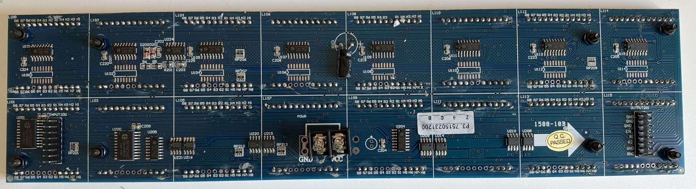
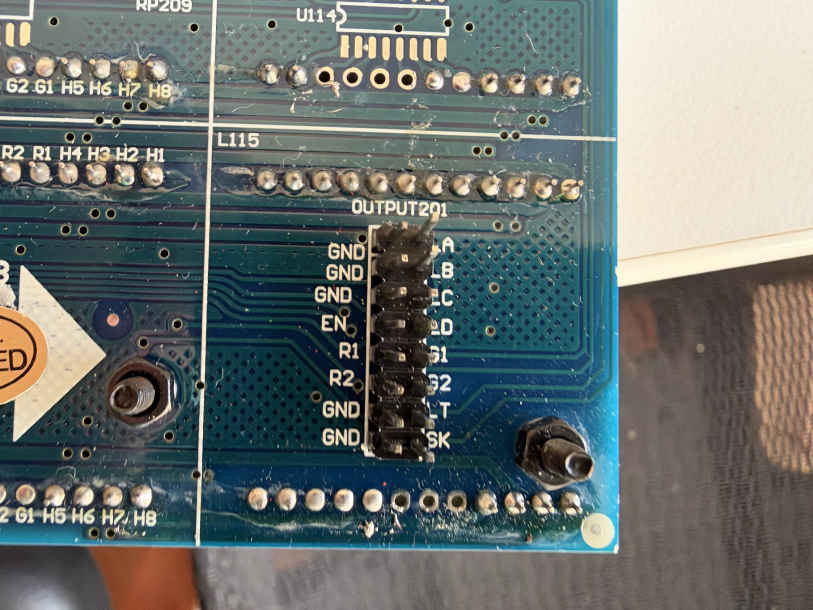

# Panel hardware and usage guide

Build a compact animated display with an **ESP32, a 5 V HUB08 panel, and Adafruit GFX**. This guide covers the working setup and the ten-scene showcase.

## What the panel can do

This red **P3.75, 64×16** panel contains sixteen 8×8 modules in an **8×2 grid**. Every pixel is individually addressable, making it suitable for text, icons, simple games, cellular automata, and motion effects. Pixels are on/off; brightness control applies to the whole display rather than to individual pixels.

The driver scans one of sixteen rows at a time. Background refresh continues while your application draws or pauses. The configured 500 µs row period gives a nominal **125 Hz complete refresh**; scene animation runs separately, typically at 25 frames per second.



*Rear PCB: INPUT200 at left, OUTPUT201 at right, power near the centre. These reference photos come from the original bring-up board.*

## Power and level shifting

Use a **regulated 5 V supply** connected directly to the panel's **VCC/GND screw terminal**. A 2–3 A supply is a practical starting point, not a measured maximum panel rating. Keep power leads short and adequately sized. Join the panel, ESP32, and level-shifter grounds. Route LED-panel current through its power terminal rather than through the ESP32 or breadboard rails.

Start at the default brightness **90/255**. Increasing brightness or the number of lit pixels increases the load. Since v1.2.0 the top of the brightness range is usable: full brightness lights each row for about 89% of its slot (previously about 50%), so peak current at 255/255 is roughly 1.8 times the v1.1.0 figure. Size the supply accordingly. USB can power the ESP32 while the separate supply powers the matrix; their grounds must be common.

Pass all eight control signals through a level shifter from ESP32 3.3 V logic to the panel's 5 V logic. The recorded setup uses an **EzSBC LS1**. Its VLo connects to 3.3 V, VHi to the panel logic supply, and each Lo channel pairs with the matching Hi channel. LS1 uses resistor pull-ups; a **74AHCT245** provides actively driven outputs and is another suitable interface. [EzSBC LS1 description](https://levelshifter.weebly.com/), [manufacturer design notes](https://news.ezsbc.com/new-level-shifter-buffer/)

### ESP32-to-matrix wiring

These are **ESP32 GPIO numbers**, not development-board header positions. Connect to **INPUT200** beside U201.

| ESP32 GPIO | Matrix signal | Config name | Function |
|:--|:--|:--|:--|
| 25 | LA | `PIN_A` | Row-address A |
| 26 | LB | `PIN_B` | Row-address B |
| 27 | LC | `PIN_C` | Row-address C |
| 13 | LD | `PIN_D` | Row-address D |
| 22 | EN | `PIN_OE` | Output enable |
| 23 | R1 | `PIN_R1` | Red pixel data |
| 4 | LT | `PIN_LAT` | Column latch |
| 18 | SK | `PIN_CLK` | Shift clock |
| GND | GND | — | Common reference |

All eight signals travel **ESP32 → low-side input → matching high-side output → matrix input**. R2/G1/G2 are unused by this firmware. The configured pins are below 32, as required by the driver's direct GPIO writes. **R1 and SK** are driven by the ESP32's VSPI hardware SPI peripheral at `SHIFT_CLOCK_HZ` (500 kHz), routed to GPIO 23/18 through the GPIO matrix.

### Connector reference

The pictured board has an unmarked INPUT200 and labelled OUTPUT201. With the **rear PCB text upright**, OUTPUT201 reads as follows. Row numbers are descriptive, not official IDC pin numbers.

```text
                    LEFT       RIGHT
Top, row 1          GND        LA
     row 2          GND        LB
     row 3          GND        LC
     row 4          EN         LD
     row 5          R1         G1
     row 6          R2         G2
     row 7          GND        LT
Bottom, row 8       GND        SK
```

The matching INPUT200 ground positions in left rows 1/2/3/7/8 were verified on this board. Use this as the connector orientation reference for this panel, not a universal pinout for every HUB08 product. OUTPUT201 is for cascading onward; this firmware controls one 64×16 panel.



### Using a 74AHCT245

For a standard 20-pin 74AHCT245, connect **pin 20/VCC and pin 1/DIR to 5 V**, and **pin 10 (GND) and pin 19 (/OE) to ground**. Add a 100 nF decoupling capacitor close to VCC/GND. This selects A-to-B direction. Verify the exact package pinout used. The chip's buffer-enable pin is separate from matrix EN. The per-signal buffer pin table is in the [ESP32 test configuration](ESP32_TEST_CONFIG.md#exact-electrical-connections). [TI datasheet](https://www.ti.com/lit/ds/symlink/sn74ahct245.pdf)

## Build and run

Open the project in **VS Code with PlatformIO**, select environment **esp32dev**, and use Build, Upload, then Serial Monitor. The project uses `espressif32@6.9.0`, Arduino, and Adafruit GFX. From the PlatformIO terminal:

```sh
pio run
pio device list
pio run --target upload
pio device monitor --baud 115200
```

Choose the USB port for your ESP32 if several devices are connected. Close an existing monitor before uploading. Reset the board with Serial Monitor open to see the startup message.

The display shows three startup cards, then enters the saved startup view: Clock + demos by default, or a held live clock. Serial prints each scene's number, name, and short description. There is no long blank interval between scenes.

### Upload over Wi-Fi (OTA)

After one USB upload of v1.3.0 or later, new firmware can be sent over the local network, for example from a laptop while the panel stays connected elsewhere.

1. Copy `include/secrets.example.h` to `include/secrets.h` (gitignored) and set `SECRET_OTA_PASSWORD`. An empty password disables network uploads.
2. Upload once over USB with `pio run --target upload`. Serial then prints `[ota] Ready: red-panel-xxxxxx.local port 3232` after Wi-Fi connects.
3. On any computer on the same network, use the same `include/secrets.h` (it is not in git) and run:

```sh
pio run -e esp32dev_ota --target upload
```

The upload reads the password from `include/secrets.h`. When changing the OTA password, put the new one in `secrets.h` and give the panel's *current* one for that single upload: `PANEL_OTA_PASSWORD='old-password' pio run -e esp32dev_ota --target upload`.

The `esp32dev_ota` environment refuses to build without `SECRET_OTA_PASSWORD`, because that firmware would switch OTA off and need USB again. It targets this panel's mDNS name, `red-panel-a4ae30.local`. For another panel, change `upload_port` or add `--upload-port <IP>`. The default `esp32dev` partition table already has two 1.25 MB app slots, so no custom table is needed; firmware uses about 0.94 MB.

The panel shows **OTA** with a percentage and progress bar, then restarts on success. If an upload fails, the current firmware keeps running and the scene returns. Flash writes pause row scanning briefly, so the progress display can flicker. The upload needs the computer and panel on the same network; macOS may ask to allow incoming connections for Python, which espota uses for the transfer. From outside your home network, use a VPN into it rather than exposing port 3232.

## Wi-Fi, location and startup status

The firmware includes **WiFiManager 2.0.17**, persistent panel settings, and NTP time. If it cannot connect using saved credentials within 10 seconds, it opens **RedPanel-XXXXXX** with setup password **PanelSetup32** (the default from `include/secrets.example.h`; set your own in a gitignored `include/secrets.h`). Join it and open **http://192.168.4.1/** to select a 2.4 GHz network.

Once connected, open **http://red-panel-xxxxxx.local/** or the serial-reported IP address (`/panel` also works). A sidebar, like this documentation's, moves between **Clock**, **Settings**, **Connection** and **Device**, and links to the Wi-Fi network and system-info pages; those pages carry a bar back to the settings. The Device section shows firmware version and whether Wi-Fi upload (OTA) is ready. Set your location label, time zone, startup brightness, startup view, clock time between demos and scrolling message. Defaults are Sydney / Australia/Sydney, 90/255, Clock + demos, 10 s and an empty message (device details). The page also shows the device's time, network and hardware settings. Saving applies brightness at once and only restarts the display when the startup view changes. Set `SECRET_PANEL_PASSWORD` in `include/secrets.h` to require a login (user `admin`) for `/panel` and its API. **`w`** reopens setup and **`i`** prints status.

Boot prints the firmware header, GPIO map, timing, orientation, location/time zone and connection details. Three 2-second panel cards show version, geometry/brightness, then network/time state. Saved settings are loaded before displaying content at the configured brightness.

Use the [complete ESP32 test configuration](ESP32_TEST_CONFIG.md) for exact buffer/header connections, provisioning, network services, persistence and acceptance checks. [Generated examples](SCREEN_EXAMPLES.md) show the expected output for all scenes and status states.

## The showcase playlist

| Key | Scene | Default time | What it demonstrates |
|:--|:--|:--|:--|
| `1` | Checkerboard | 1.2 s | Six alternating pixel patterns |
| `2` | Bouncing balls | 5.6 s | Three independent paths, filled and outlined circles |
| `3` | Starfield | 5.6 s | Twenty-four stars, three speeds, short trails |
| `4` | Pixel rain | 6 s | Staggered falling trails of different lengths |
| `5` | Animated bars | 6.4 s | Eight smoothly interpolated bars and peak marks |
| `6` | Conway's Life | 7.2 s | Gliders and blinkers with wrapping edges |
| `7` | Beating hearts | 4 s | Three enlarged pixel-art hearts with pulsing brightness |
| `8` | Scrolling text | Length of message | Size-2 text; always scrolls fully before the clock returns |
| `9` | Pong | 16 s | Automatic paddles, ball physics, goals, and a small scoreboard |
| `c` | Live clock | Web setting, default 10 s; held by `c` | NTP local time, large HH:MM:SS digits, blinking colons, day and date |

**Clock → checkerboard → clock → balls → clock → stars**, and so on through Pong, then repeat. The clock time between demos is set on the settings page (5–3600 s, default 10). A complete rotation is about **three minutes** with the defaults; the device-details message takes roughly 40 seconds to scroll, at 12 pixels per character and 25 steps per second.

**Scrolling text** shows the message saved on the settings page: up to 64 plain characters (space to `~`), so the panel font can draw every one. Left empty, it shows device details composed when the scene starts, for example `RED PANEL v1.6.0 - UP 2H 05M - SYNCED 3M 10S AGO - 192.168.1.163 - Sydney`. The scene length is worked out from the message width, so the whole message always crosses the panel before the clock returns. A directly selected demo returns to the clock, then advances to the following demo. `n` follows the same clock/demo alternation. The bars are a simulated equalizer, not an audio measurement. Life is a real cellular-automaton update: a cell survives with two or three neighbours and is born with three. It starts from the same gliders and blinkers each time that scene is entered.

Hearts vary the whole-panel requested brightness from about one fifth of your selected level up to that level. The display is monochrome, so the star and rain trails use shapes and spacing rather than per-pixel grey levels.

### Pong and live clock

**Pong** is a fully automatic match. Two paddles follow a two-pixel ball, which rebounds off the top, bottom, and paddles. Paddles sometimes miss after a rally so goals and new serves occur. Each score is a single digit that wraps after 9; selecting `9` starts a fresh match. Use `p` to freeze or resume play.

**Clock** displays real local time after synchronising with NTP. It uses the saved time zone for daylight saving. Before the first sync it shows **NO WIFI / JOIN AP** or **SYNC TIME / WAIT NTP**. The lower row shows the day and date in small capitals, for example **SUN 25 OCT 2026**. Colons light for the first half of each real second while Wi-Fi is connected; **solid colons** mean the clock is holding time offline from its last sync. Without a fresh sync for 24 hours (`CLOCK_HOLDOVER_MAX_MS`) the clock returns to its waiting display rather than showing drifted time. Selecting `c` holds the clock without resetting it; pausing the playlist leaves time running. No RTC module is required, but a fresh boot waits for network time.

## Serial controls

Click inside the PlatformIO **Serial Monitor terminal** and type a key. **No Enter or comma is required.** Letter commands also accept uppercase. Local echo may be off; the firmware's printed response confirms receipt.

| Key | Action |
|:--|:--|
| `1`–`9` | Start the chosen scene, then continue the playlist (`9` starts a fresh Pong match) |
| `c` | Hold the live clock; does not reset the time |
| `w` | Open the Wi-Fi setup hotspot without erasing settings |
| `i` | Print the startup/settings status report |
| `d` | Cycle runtime debug level 0–4 |
| `n` | Start the next scene; resumes if paused |
| `p` | Pause/resume the playlist; refresh and live clock continue |
| `r` | Restart at the clock, with the checkerboard next |
| `s` | Jump directly to the scrolling message, then continue the playlist |
| `f` | Hold all pixels OFF |
| `o` | Hold all pixels ON at the selected brightness |
| `b` | Blank the output at brightness zero |
| `+` / `-` | Change requested brightness by 15, bounded to 0–255; `=` also increases it |
| `?` / `h` | Print help, scene list, and selected brightness |

From held `f/o/b`, **`p`, `r`, or `n` returns to the clock** (`r` also resets the next demo to the checkerboard). Scene keys (`1`–`9`, `c`) also leave any held pattern. Changing brightness preserves the current frame and pause state; `b` remains blank even if you increase the selected level. The selected brightness persists between scenes. Five seconds after the last `+`/`-` (`BRIGHTNESS_SAVE_DELAY_MS`) it is saved as the startup brightness, so a burst of key presses writes flash once. Brightness zero remains dark until increased again.

Requested brightness is an on-time setting (`level × 500 µs / 255`), not a calibrated light percentage. The next row is shifted while the current row is lit, so only the latch and a 50 µs guard are dark; the on-time caps at about 445 µs, so roughly 228–255 look the same.

For a quick orientation check, send `c` and `p`: the clock digits and the day/date row should read left to right, top to bottom. `o` lights every pixel to find dead or stuck modules. (The letter test used during bring-up was removed in v1.6.0.)

## Customise the showcase

The scrolling message and clock time between demos are set on the settings page; no rebuild is needed. For everything else, edit [include/config.h](../include/config.h), rebuild, and upload:

| Setting | Default | Purpose |
|:--|:--|:--|
| `DEFAULT_BRIGHTNESS` | 90 | Fallback brightness before any web setting is saved |
| `CHECKER_STEP_MS` | 200 | Time per checkerboard phase |
| `ANIMATION_STEP_MS` | 40 | Frame interval for balls, stars, bars, and hearts |
| `RAIN_STEP_MS` | 50 | Rain frame interval |
| `LIFE_STEP_MS` | 100 | Time per Life generation |
| `SCROLL_STEP_MS` | 40 | Time per one-pixel scroll step |
| `PONG_STEP_MS` | 40 | Pong physics and drawing interval |
| `CLOCK_STEP_MS` | 250 | Live-clock redraw interval; time comes from NTP/system clock |
| `DEFAULT_CLOCK_HOLD_S` | 10 | Clock time between demos until one is saved on the settings page |
| `CLOCK_HOLDOVER_MAX_MS` | 86400000 | Offline time before the clock stops claiming valid time |
| `BRIGHTNESS_SAVE_DELAY_MS` | 5000 | Quiet period before serial brightness is saved |
| `WIFI_CONNECT_TIMEOUT_MS` | 10000 | Saved connection attempt before setup hotspot |
| `WIFI_SAVE_CONNECT_TIMEOUT_MS` | 8000 | Association window after saving new credentials |
| `SHIFT_CLOCK_HZ` | 500000 | SPI clock for column data; raise only after a hardware check |
| `OTA_PORT` | 3232 | Network upload port; must match `platformio.ini` |
| `BOOT_CARD_MS` | 2000 | Time per startup card |

Scene frame counts are in the `scenes` table in [src/main.cpp](../src/main.cpp). Each render draws into the working buffer and calls `show()`. A demo's duration is its frame count multiplied by its interval; scrolling derives its frame count from the message width. If the application is delayed, it advances one frame rather than replaying a backlog. Clock visits end by elapsed milliseconds only and preserve their remaining time across pauses. The clock redraw interval changes animation cadence only; it does not change the speed of time.

### Orientation and scan settings

| Setting | Value |
|:--|:--|
| Geometry | 64×16; 1/16 scan |
| Column stream | `REVERSE_SHIFT_COLUMNS = true` |
| A/B/C/D source bits | `ROW_ADDRESS_Y_BITS = {0, 1, 2, 3}` |
| Row-address inversion | `ROW_ADDRESS_XOR = 0x0F` |
| Data / output-enable polarity | `DATA_ACTIVE_LOW = true`, `OE_ACTIVE_LOW = true` |
| Row period / signal phase / guard | 500 µs / 1 µs / 50 µs |
| Column shift | VSPI at 500 kHz, overlapped with the lit row |

These values match the working panel orientation. Drawing coordinates remain **(0,0) at top left**. Changing geometry alone does not make the driver a generic multi-panel cascade driver.

## Draw your own content

`Hub08Panel` derives from `Adafruit_GFX`. Colour **0 is OFF** and a nonzero colour is ON. Draw text or graphics, then call **`show()`**. For a permanent label, replace the demo application in `src/main.cpp` with:

```cpp
#include <Arduino.h>
#include "Hub08Panel.h"

Hub08Panel panel;

void setup() {
  Serial.begin(115200);
  panel.begin();
  panel.setBrightness(DEFAULT_BRIGHTNESS);
  panel.setTextWrap(false);
  panel.setTextSize(1);
  panel.setTextColor(1);
  panel.fillScreen(0);
  panel.setCursor(1, 0);
  panel.print("READY");
  panel.setCursor(1, 8);
  panel.print("ESP32");
  panel.show();
}

void loop() {
  delay(10);  // Background scanning keeps the label visible.
}
```

Use this instead of the original `setup()`/`loop()`, rather than adding a second pair. To draw a border, line, and circle after initialisation:

```cpp
panel.fillScreen(0);
panel.drawRect(0, 0, PANEL_WIDTH, PANEL_HEIGHT, 1);
panel.drawLine(0, 0, PANEL_WIDTH - 1, PANEL_HEIGHT - 1, 1);
panel.drawCircle(32, 8, 5, 1);
panel.show();
```

Size-1 text fits two rows of small characters. Size-2 text gives a single 14-pixel-tall line, as used by the scroller. `setTextWrap(false)` lets text move through the screen edges. GFX clips drawing to the framebuffer and honours `setRotation()`.

### Driver API

| Method | Use |
|:--|:--|
| `begin()` | Initialise pins and SPI, preload blank data, start background refresh; call once |
| `drawPixel(x, y, colour)` | Set a pixel, with clipping and GFX rotation |
| `fillScreen(colour)` | Clear or fill the drawing buffer |
| `show()` | Queue the drawing buffer for the next complete scan |
| `setBrightness(level)` | Set requested row on-time; zero blanks output |
| `rowAddressFor(y)` | Return the mapped hardware address for a logical row |
| `refreshStats()` | Snapshot cumulative rows/deadlines and maximum wake/scan times |

The working, pending and active framebuffers each occupy **128 bytes**. `show()` copies to the pending buffer; refresh applies it only when row zero of the next scan is prepared, so one complete scan uses one picture. Brightness changes as row zero is latched.

Hardware timer **TG0/T0** sets the 500 µs row cadence and blanks output. A dedicated high-priority task on core 1 then sets the address and latches the columns that were shifted during the previous slot, lights the row, and shifts the following row's 64 bits over hardware SPI while this one is lit. The 74HC595 outputs only change on LT, so shifting does not disturb the lit row. **TG0/T1** ends the brightness pulse in a short interrupt; the row interrupt supplies a second blanking deadline. Late rows remain dark and missed ticks are skipped. These two timers are reserved for the panel. Their IRAM handlers use shared interrupts at an available level 1–3, avoiding the two exclusive level-3 allocations that caused a blank display during startup. [ESP-IDF interrupt allocation](https://docs.espressif.com/projects/esp-idf/en/v4.4.8/esp32/api-reference/system/intr_alloc.html) Interrupts do not shift data or print logs. This removes row work from the shared `esp_timer` task that Wi-Fi activity can delay. The pin map, polarity, 1 µs address/latch phases and nominal 125 Hz refresh are unchanged from v1.1.0. The v1.2.0 overlapped SPI shift was checked on the reference panel on 25 October 2026: normal display through 255/255, with zero missed ticks or late rows over more than 500,000 rows ([recorded result](ESP32_TEST_CONFIG.md#recorded-reference-panel-result-v1-2-0-25-october-2026)). On another panel, if output ghosts or misplaces columns, try a lower `SHIFT_CLOCK_HZ` and report the `i` refresh counters. [ESP-IDF hardware timer reference](https://docs.espressif.com/projects/esp-idf/en/v4.4.8/esp32/api-reference/peripherals/timer.html), [ESP timer dispatch limitations](https://docs.espressif.com/projects/esp-idf/en/v4.4.8/esp32/api-reference/system/esp_timer.html)

This addresses possible timing jitter and frame tearing. On 25 October 2026 the user confirmed no visible flicker on the reference panel; two held-letter readings showed increasing rows and unchanged missed/late counters. See the [recorded v1.1.0 result](ESP32_TEST_CONFIG.md#recorded-reference-panel-result-v1-1-0-25-october-2026) for the measurements and scope. Flash writes can still pause the scan task briefly. See the [bench flicker check](ESP32_TEST_CONFIG.md#check-display-flicker); camera banding is a separate exposure effect.

## Photographing the display

Hold the clock with `c`, or pause an animation with `p`. A camera can record bands because its exposure interacts with row scanning. Try a supported camera at **1/25 second and low ISO**, then adjust exposure as needed. At the nominal refresh rate this spans five complete scans. [Sony guidance on LED banding](https://www.sony.com.au/electronics/support/articles/00122281)

## Debug and formatting

Logs use the shared runtime levels: 0 Off, 1 Error `[ERR ]`, 2 Warn `[WARN]`, 3 Info `[INFO]`, and 4 Verbose `[VERB]`. `DEBUG_LEVEL` in PlatformIO sets the boot level, and serial `d` cycles it; its confirmation prints at every level through `DBG_ALWAYS`. INFO prints startup settings and scene/network transitions; frequent details use VERBOSE. Wi-Fi passwords are not logged.

C++ follows two-space indentation, attached braces and a 100-column limit in [.clang-format](../.clang-format). See the [test setup](ESP32_TEST_CONFIG.md#boot-status-and-debug-conventions) for formatting and host-check commands.

## Reference material

Open [index.html](../index.html) for the single-page HTML edition of all documentation. The [photo gallery](PHOTO_LOG.md) provides connector and component close-ups; [manifest.json](../images/manifest.json) records the original attachment checksums. Rebuild it and the share ZIP using the instructions in [README.md](../README.md).

Earlier diagnostic commands and electrical measurements are retained in the [archived bring-up report](BRING_UP_REPORT.md). That report describes the older test firmware, not the current showcase controls.
