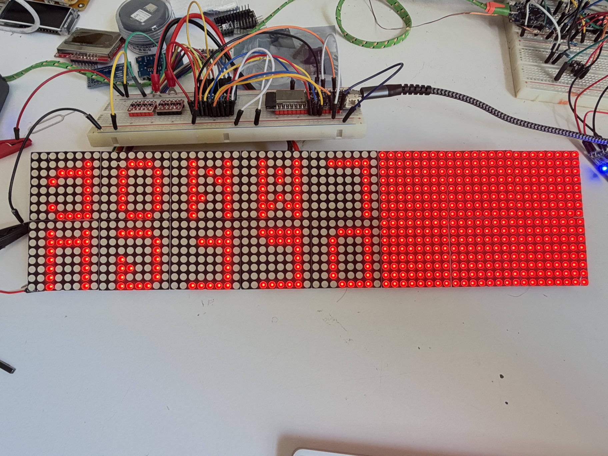
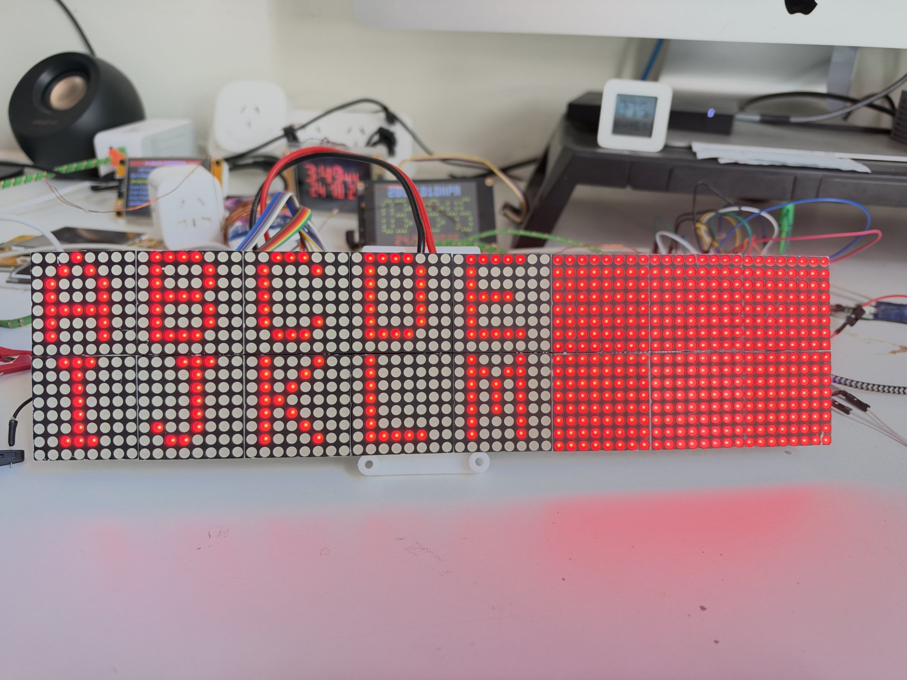
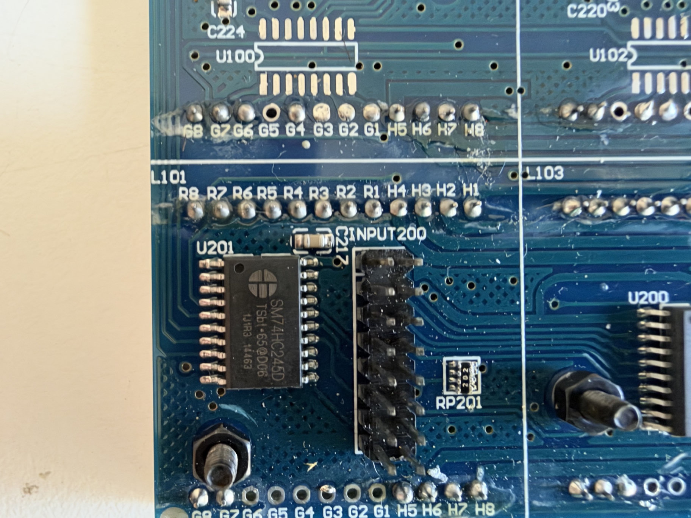
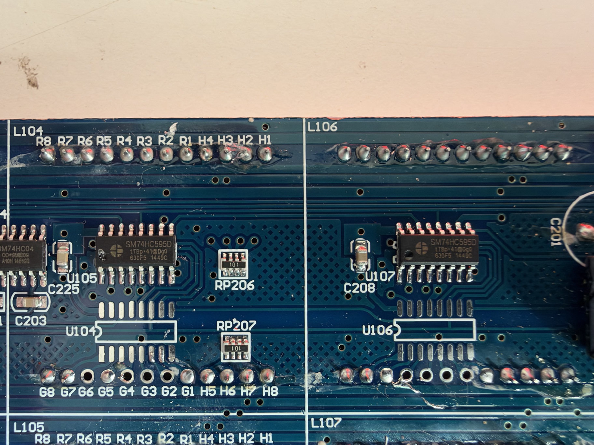

# Panel and connector photos

Six reference photographs from the original panel bring-up: front patterns, the complete rear PCB, connector labels, and driver close-ups. The front images show the earlier faulty board; use them as historical examples, not as expected output from the current showcase. See the [archived report](BRING_UP_REPORT.md) for that investigation.

Click a photograph or its full-size link to inspect it separately. Files preserve the available attachment resolution without re-encoding. [File manifest and checksums](../images/manifest.json).

## 01 — Static letters before mapping correction

The first `t` photograph shows readable glyph structure on the responding left section, with reversed character placement and displaced row strokes. The right three module columns, across both rows, are fully lit. It motivated a coordinate-mapping check rather than treating the whole picture as camera banding.

[Open full-size image](../images/01-static-before-mapping.jpg) · Available size: **1824×1368**.

## 02 — Corrected letter placement, section fault remains

The left five columns now show ABCDE above IJKLM. The right section remains fully lit. At this point code still included the temporary B/C exchange; the owner subsequently found and corrected crossed GPIO 26/27 wiring and that software compensation was removed. This is a progress image of the faulty panel, not the successful replacement.

[Open full-size image](../images/02-static-after-mapping.jpg) · Available size: **1824×1368**.

## 03 — Complete rear PCB

The rear view establishes module and component locations. INPUT200 is beside U201 at the left; OUTPUT201 is at the right. The front-right stuck section corresponds to the rear-left U101/U103/U105 area. The transition is near U105/U107. This is a physical location reference, not proof of serial-chain direction.

[Open full-size image](../images/03-panel-rear.jpg) · Available size: **2048×559**.

## 04 — OUTPUT201 labels

This connector supplied the visible pin-label reference. The R1 contact used for the output measurement is the left column, fifth row from the top in this orientation. The layout was initially assumed to apply to INPUT200; its ground pattern was then checked separately.

[Open full-size image](../images/04-output201-header.jpg) · Available size: **1824×1368**.

## 05 — Unmarked INPUT200 and U201

The photo shows why input assignments could not be independently read from silkscreen labels. It also identifies the onboard buffer family. Ground continuity was checked against the matrix GND terminal with all power removed. The populated and unpopulated LED pads reflect the board variant and should not automatically be treated as damage.

[Open full-size image](../images/05-input200-header.jpg) · Available size: **1824×1368**.

## 06 — U105/U107 latch-check area

U105 is at the left and U107 at the right. U107's pin-1 dot is visible at the lower-left of the package. For that orientation the top legs run 16 through 9 left to right, making latch pin 12 the fifth top leg from the left. Resistance between the two pin-12 nodes was reported as OL. Comparative readings on other chip pairs were proposed but not reported before the panel was replaced.

[Open full-size image](../images/06-u105-u107-closeup.jpg) · Available size: **1824×1368**.

## Image files

The six JPEG files total approximately **2.85 MB**. [manifest.json](../images/manifest.json) records their byte counts, dimensions, and SHA-256 hashes.

Use the [panel guide](PANEL_GUIDE.md) for wiring and running the current showcase.
