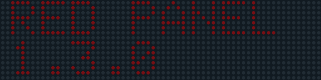
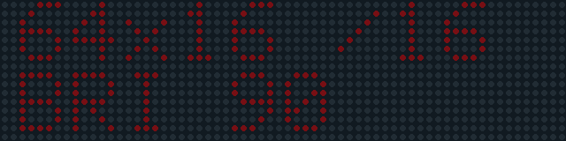
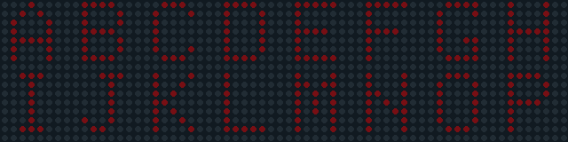
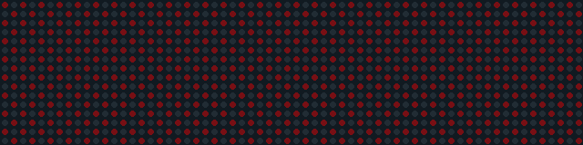

# Screen output examples

Generated from the actual `src/main.cpp` drawing routines and installed Adafruit GFX library, using host fixtures for panel GPIO, Wi-Fi and time. These are **rendered examples, not photographs or proof of hardware operation**.

Each dot represents one pixel. GIFs sample animation frames to keep the archive compact; dot colour and brightness are illustrative, not calibrated light measurements. Clock values come from a fixed host time and do not represent the time when you open this document.

Use the [panel guide](PANEL_GUIDE.md) for controls and the [ESP32 test configuration](ESP32_TEST_CONFIG.md) for wiring, Wi-Fi and bench checks.

## 01 — Boot 1

Startup header and firmware version.



## 02 — Boot 2

Panel geometry, scan ratio and selected brightness.



## 03 — Boot 3

Network/time status. This fixture is connected and synchronised; a fresh offline boot shows waiting states instead.


## 04 — Letters

Key 1, or t to hold: A-H above I-P, one letter per 8x8 module.



## 05 — Checkerboard

Key 2: alternating single-pixel phases.



## 06 — Bouncing balls

Key 3: independent moving circles, filled and outlined.


## 07 — Starfield

Key 4: several speeds and short horizontal star trails.


## 08 — Pixel rain

Key 5: staggered falling trails.


## 09 — Animated bars

Key 6: simulated equalizer bars; no audio input.


## 10 — Conway's life

Key 7: actual glider/blinker updates on wrapping edges.


## 11 — Beating hearts

Key 8: enlarged pixel art with whole-display brightness modulation.


## 12 — Scrolling text

Key 9 or s: full-height text crossing the screen.


## 13 — Pong

Key g: automatic paddles, collisions, goals and fresh serves.


## 14 — Clock

Starts the cycle and returns for 10 seconds between demos. Key c holds it indefinitely: local HH:MM:SS, blinking colons, seconds bar and NTP source label. Captured with a fixed network-time fixture.


## 15 — All pixels off

Key f: an empty pixel buffer at the selected brightness.


## 16 — All pixels on

Key o: every pixel on at the selected brightness.


## 17 — Output blanked

Key b: output disabled. Visually dark like f; it uses zero output on-time.


## 18 — Clock offline holdover

Time continues from its last sync; HLD replaces the NTP label.


## 19 — Clock waiting for Wi-Fi

No valid time yet: NO WIFI / JOIN AP. No sample epoch is displayed.


## 20 — Clock waiting for NTP

Wi-Fi is connected, but time has not arrived: SYNC TIME / WAIT NTP.


## Regenerate and verify

Install the project libraries with `pio pkg install`. With a C++17 compiler and the dependencies in `tools/docs-requirements.txt`, run:

```sh
python3 tools/render_examples.py
python3 tools/build_docs.py
```

The renderer runs host regressions with address/undefined-behaviour sanitizers before writing these GIFs and their [manifest](../images/demos/manifest.json). Tests cover clock/demo alternation and deadlines, controls, Conway rules, Pong, live-clock/DST/holdover, settings validation, portal/LAN routes, NVS failure/reload and reconnects. The actual refresh driver is exercised with timer/GPIO fixtures for scan-boundary frames, OE deadlines, late rows and brightness. Real interrupt latency, Wi-Fi association, captive portals and electrical output require the bench checks.

Original panel photographs remain separate in the [hardware photo log](PHOTO_LOG.md).
